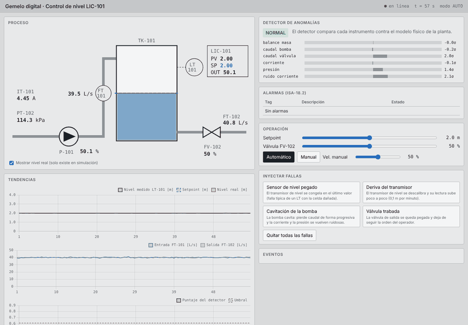
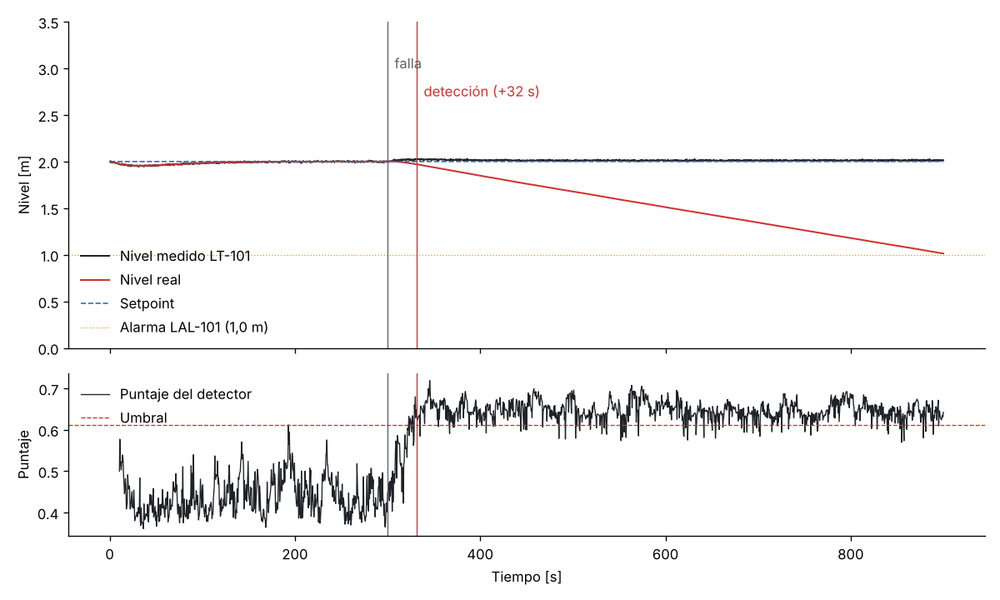
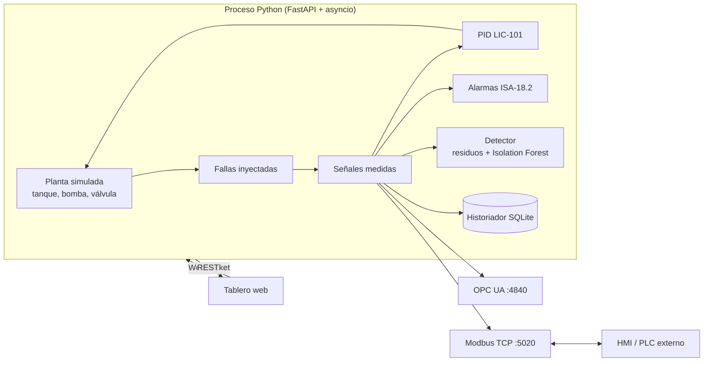

# Gemelo Digital de Planta con Detección de Fallas

[](https://github.com/carlosm9602/gemelo-digital-planta/actions/workflows/ci.yml) [](LICENSE)   

### Una planta industrial simulada que se puede dañar a propósito, y un modelo que detecta la falla antes de que suene la alarma, o cuando la alarma nunca va a sonar.



*En el GIF se inyecta una deriva en el transmisor de nivel LT-101. La lectura sigue en el setpoint y ninguna alarma suena, pero el nivel real (línea roja) va bajando. El detector lo marca en menos de un minuto y dice qué instrumento revisar.*

> Gemelo digital de un proceso de nivel y caudal: simulador con lazo PID, servidor Modbus TCP y OPC UA, tablero SCADA web en tiempo real, inyección de fallas y detección de anomalías con ML.

## Índice

1. [¿Qué problema resuelve?](#qué-problema-resuelve)
2. [Resultados](#resultados)
3. [Funcionalidades](#funcionalidades)
4. [Tecnologías](#tecnologías)
5. [Arquitectura](#arquitectura)
6. [Estructura del proyecto](#estructura-del-proyecto)
7. [Inicio rápido](#inicio-rápido)
8. [Pruebas](#pruebas)
9. [Hoja de ruta](#hoja-de-ruta)
10. [In English](#in-english)
11. [Licencia](#licencia)
12. [Autor](#autor)

## ¿Qué problema resuelve?

En planta, las alarmas por umbral avisan cuando el problema ya ocurrió. Y hay fallas que nunca las disparan: si el transmisor de nivel se pega o se descalibra, el controlador confía en él, el SCADA muestra el valor de siempre y el tanque se vacía o se rebosa sin que nada suene.

Este proyecto simula un proceso de tanque, bomba y válvula con su lazo PID y señales 4-20 mA, lo expone por Modbus TCP y OPC UA como lo haría un PLC, y lo muestra en un tablero tipo SCADA. Desde el tablero se inyectan cuatro fallas reales (sensor pegado, deriva del transmisor, cavitación de la bomba, válvula trabada) y un detector las encuentra comparando cada instrumento contra la física del proceso.

## Resultados

Medidos con `python -m analitica.evaluar --escenarios 20 --horas-normales 8`: 20 escenarios por falla con apertura y setpoint distintos, la falla inyectada con la planta estable y 15 minutos de observación. El tiempo se cuenta desde que se inyecta la falla.

| Falla | Detectadas por el modelo | Tiempo mediano del modelo | Diagnóstico correcto | Alarmas por umbral que sonaron | Tiempo mediano de la alarma |
|---|---|---|---|---|---|
| Sensor de nivel pegado | 19/20 | 127,5 s | 17/19 | 0/20 | nunca |
| Deriva del transmisor | 20/20 | 28,8 s | 19/20 | 2/20 | 891,0 s |
| Cavitación de la bomba | 20/20 | 3,8 s | 20/20 | 6/20 | 358,5 s |
| Válvula trabada | 20/20 | 28,5 s | 20/20 | 0/20 | nunca |

**Cero falsas detecciones en 8 horas** de operación normal con un operador cambiando setpoint y válvula.

Sumando todo: 79 de 80 fallas detectadas y 76 de esas 79 bien diagnosticadas, mientras que las alarmas clásicas solo sonaron en 8 de los 80 casos. El único sensor pegado que no se detectó se congeló justo en el setpoint (1,80 m) y el nivel real se quedó ahí mismo durante los 15 minutos. Mientras el proceso no cambia, ninguna medición puede delatar un sensor pegado, porque coincide con la realidad.



La válvula trabada solo se puede detectar cuando el operador intenta moverla; en la evaluación eso pasa entre 10 y 40 s después de la falla, y ese tiempo está incluido. Todos los números salen de la simulación; el cuaderno [`notebooks/evaluacion_detector.ipynb`](notebooks/evaluacion_detector.ipynb) los reproduce con semillas fijas.

## Funcionalidades

- Simulador de proceso con balance de masa, rampa del variador, dinámica del actuador, ruido de instrumentos y PID con anti-windup y transferencia sin salto entre manual y automático
- Servidor Modbus TCP y OPC UA con mapa de registros documentado; un HMI o PLC externo puede leer la planta y cambiar setpoint, válvula y modo
- Tablero web con diagrama del proceso, tendencias, setpoint editable y alarmas con el ciclo de vida de ISA-18.2 (activa, reconocida, normalizada sin reconocer)
- Botones de inyección de fallas: sensor pegado, deriva, cavitación, válvula trabada
- Detector de anomalías con residuos físicos e Isolation Forest, con diagnóstico en lenguaje de planta ("revisar el transmisor LT-101")
- Historiador en SQLite con muestras y eventos, consultable por API
- API REST documentada con OpenAPI en `/docs`

## Tecnologías

| Herramienta | Para qué |
|---|---|
| Python 3.11 | Todo el backend |
| NumPy | Simulación del proceso |
| scikit-learn | Isolation Forest y normalización de residuos |
| FastAPI + WebSocket | API REST y envío de muestras a 2 Hz |
| pymodbus | Servidor Modbus TCP |
| asyncua | Servidor OPC UA |
| SQLite | Historiador |
| Chart.js + SVG | Tablero web estilo HMI de alto desempeño (ISA-101) |
| Docker Compose | Despliegue en un comando |
| pytest + ruff + GitHub Actions | 26 pruebas, lint y CI en cada push |

## Arquitectura



El detector no mira las señales en crudo. Primero calcula lo que debería medir cada instrumento según la física (balance de masa, curva de la bomba, ecuación de la válvula, columna de agua en la presión) y le entrega al modelo solo las diferencias. En operación normal esas diferencias son ruido alrededor de cero sin importar el punto de operación, así que con 3 horas de datos simulados el modelo queda entrenado y no confunde un cambio de setpoint con una falla.

Detalle del ciclo, los residuos y las decisiones de diseño en [docs/arquitectura.md](docs/arquitectura.md). Mapa Modbus y nodos OPC UA en [docs/mapa_registros.md](docs/mapa_registros.md).

## Estructura del proyecto

```text
gemelo-digital-planta/
├── .github/workflows/ci.yml
├── docs/
│   ├── arquitectura.md          # ciclo, residuos, decisiones
│   ├── mapa_registros.md        # Modbus y OPC UA
│   ├── caso_deriva.png
│   ├── demo.gif
│   └── tablero.png
├── notebooks/
│   └── evaluacion_detector.ipynb
├── src/
│   ├── analitica/
│   │   ├── detector.py          # residuos físicos, Isolation Forest, diagnóstico
│   │   ├── entrenar.py
│   │   └── evaluar.py           # detector contra alarmas
│   ├── api/
│   │   ├── historiador.py
│   │   └── main.py              # FastAPI, ciclo de 0,5 s, WebSocket
│   ├── comunicacion/
│   │   ├── servidor_modbus.py
│   │   └── servidor_opcua.py
│   └── planta/
│       ├── alarmas.py           # ISA-18.2
│       ├── fallas.py
│       ├── pid.py
│       └── simulador.py
├── tests/                       # 26 pruebas
├── web/                         # tablero (HTML, JS, Chart.js local)
├── docker-compose.yml
├── Dockerfile
└── pyproject.toml
```

## Inicio rápido

Con Docker:

```bash
git clone https://github.com/carlosm9602/gemelo-digital-planta.git
cd gemelo-digital-planta
docker compose up --build
```

Sin Docker (Windows PowerShell, Linux o macOS):

```bash
git clone https://github.com/carlosm9602/gemelo-digital-planta.git
cd gemelo-digital-planta
python -m venv .venv
.venv\Scripts\activate          # en Linux/macOS: source .venv/bin/activate
pip install -e ".[dev]"
uvicorn api.main:app --app-dir src --port 8000
```

Luego:

| Qué | Dónde |
|---|---|
| Tablero SCADA | http://localhost:8000 |
| Documentación de la API | http://localhost:8000/docs |
| Modbus TCP | `localhost:5020`, unidad 1 |
| OPC UA (con `OPCUA=1`) | `opc.tcp://localhost:4840/gemelo/` |

La primera vez el detector se entrena solo (unos segundos). Para ver una falla rápido, arranca con `VELOCIDAD_SIM=5` y pulsa **Deriva del transmisor** con la casilla "Mostrar nivel real" activada.

## Pruebas

Las pruebas corren en cada push con GitHub Actions. En local:

```bash
pip install -e ".[dev]"
ruff check .
pytest -v
python -m analitica.evaluar --escenarios 20   # regenera la tabla de resultados
```

Cubren el PID (convergencia, anti-windup, transferencia sin salto), cada falla, el ciclo de vida de las alarmas, el detector (cero falsas alarmas en una hora normal; detecta y diagnostica cavitación, deriva y válvula trabada) y la API completa con WebSocket.

## Hoja de ruta

- [x] Versión inicial: simulador, PID, Modbus, OPC UA, alarmas, detector y tablero
- [ ] Conectar el detector a un PLC real (S7-1200 o Micro850) leyendo por Modbus en vez del simulador
- [ ] Más fallas: fuga en el tanque, desgaste progresivo del impulsor, ruido eléctrico en el lazo 4-20 mA
- [ ] Historiador en InfluxDB con tablero Grafana
- [ ] Estimación de vida útil restante de la bomba a partir de la tendencia del residuo

## In English

A digital twin of a tank level process (pump, valve, PID loop, 4-20 mA signals) that exposes itself over Modbus TCP and OPC UA like a real PLC, with a web SCADA dashboard and ISA-18.2 alarms. You can inject four realistic faults from the dashboard. A physics-informed anomaly detector (residuals from mass balance, pump and valve curves, fed to an Isolation Forest) caught 79 of 80 simulated faults, most of them long before any threshold alarm fired, and correctly diagnosed 76. Classic alarms fired in only 8 of the 80 cases. It made zero false detections in 8 hours of normal operation. Stack: Python, FastAPI, WebSocket, scikit-learn, pymodbus, asyncua, SQLite, Chart.js, Docker, pytest and GitHub Actions.

## Licencia

Distribuido bajo licencia MIT. Ver [LICENSE](LICENSE).

## Autor

**Carlos Mario Hidalgo Becerra**, ingeniero electrónico y mecánico, instructor SENA y fundador de Quantix Engineering.

[GitHub](https://github.com/carlosm9602) · [LinkedIn](https://www.linkedin.com/in/carlos-mario-hidalgo-becerra-866b62173) · [Quantix Engineering](https://quantix-engineering.web.app)
