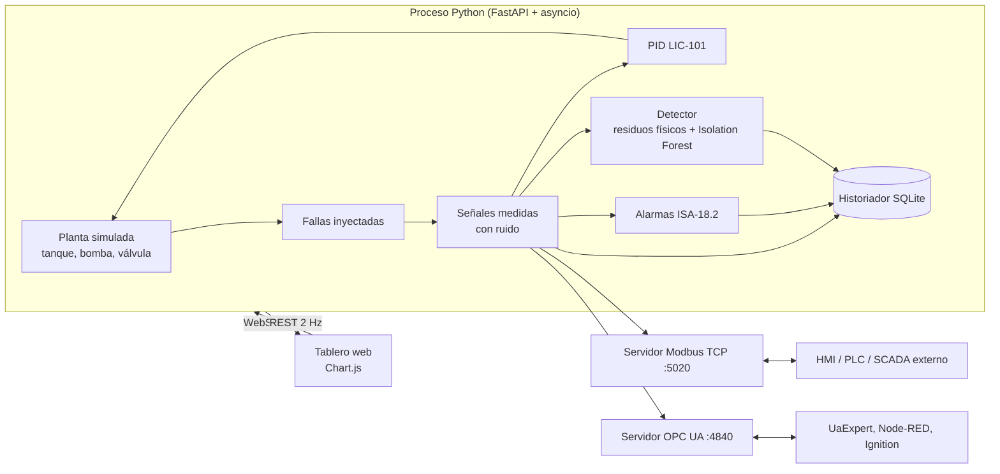

# Arquitectura

## El ciclo de 0,5 s

Cada medio segundo el proceso hace lo mismo, en este orden:

1. Lee los holding registers Modbus por si un HMI externo cambió el setpoint, la válvula o el modo.
2. Mide el nivel (aquí actúan las fallas del transmisor), calcula el PID y mueve la bomba con la rampa del variador.
3. Mueve la válvula con la dinámica de primer orden del actuador (aquí actúa la válvula trabada).
4. Integra el balance de masa del tanque: `A·dh/dt = Qe − Qs`, con `Qs = Cv·apertura·√h`.
5. Genera las lecturas de campo (caudales, corriente, presión) con ruido; aquí actúa la cavitación.
6. Evalúa alarmas, corre el detector, guarda en el historiador, publica por Modbus y OPC UA y envía la muestra por WebSocket.

## Por qué residuos y no señales crudas

Un modelo entrenado con las señales en crudo aprende "cómo se ven los números" en las condiciones que vio. Si el operador sube el setpoint a un valor que no estaba en el entrenamiento, ese modelo lo marca como anomalía.

El gemelo calcula primero lo que **debería** medir cada instrumento según la física, y le entrega al modelo solo las diferencias:

| Residuo | Qué compara | Qué falla lo dispara |
|---|---|---|
| `r_balance` | A·dh/dt medido contra Qe − Qs medidos | Transmisor de nivel pegado o con deriva |
| `r_bomba` | Qe medido contra Qmax·velocidad | Cavitación, desgaste del impulsor |
| `r_valvula` | Qs medido contra Cv·apertura·√h | Válvula trabada, o nivel mal medido |
| `r_corriente` | Corriente contra la curva del motor | Cavitación, problemas mecánicos |
| `r_presion` | Presión de descarga contra la curva de la bomba más la columna de agua | Cavitación, o nivel mal medido |
| `ruido_corriente` | Desviación estándar del residuo de corriente | Cavitación, vibración |

En operación normal todos son ruido alrededor de cero sin importar el punto de operación. Por eso alcanzan 3 horas de datos simulados para entrenar y por eso el detector no da falsas alarmas cuando el operador mueve cosas.

## Detección y diagnóstico

- **Isolation Forest** (scikit-learn) sobre los 6 residuos normalizados. Umbral en el percentil 99,9 de los datos normales.
- **Límite por residuo**: Isolation Forest se satura cuando un solo residuo se dispara muy lejos, porque la mayoría de árboles no cortan por esa variable. Por eso también se marca anomalía si cualquier residuo supera 1,2 veces el máximo visto en entrenamiento.
- **Retardo y liberación**, igual que una alarma: 6 muestras seguidas (3 s) para activar y 20 (10 s) para volver a normal. Así no parpadea.
- **Diagnóstico por reglas físicas** sobre el patrón de residuos. La presión de descarga incluye la columna de agua (9,81 kPa por metro), así que funciona como un segundo medidor de nivel independiente del LT-101. Si el transmisor miente, el caudal esperado por la válvula y la presión esperada se equivocan en el mismo sentido y en proporción; si la válvula se traba, la presión cuadra y solo falla el caudal.

## Decisiones

| Decisión | Por qué |
|---|---|
| Un solo proceso asyncio | La planta, Modbus, OPC UA y el WebSocket comparten estado sin colas ni bloqueos. A 2 Hz sobra rendimiento. |
| Modbus en el puerto 5020 | El 502 pide permisos de administrador en Linux y en Windows suele estar bloqueado por el firewall corporativo. |
| Chart.js servido localmente | Las redes de planta casi nunca tienen salida a internet. |
| SQLite como historiador | Cero instalación. Para producción se cambiaría por InfluxDB o TimescaleDB sin tocar el resto. |
| `pymodbus` fijado en 3.8 | Las versiones 3.9 en adelante cambiaron la API del datastore. |
| Nivel real visible en el tablero | Solo existe en simulación; sirve para mostrar que el transmisor está mintiendo mientras el SCADA dice que todo está bien. |
